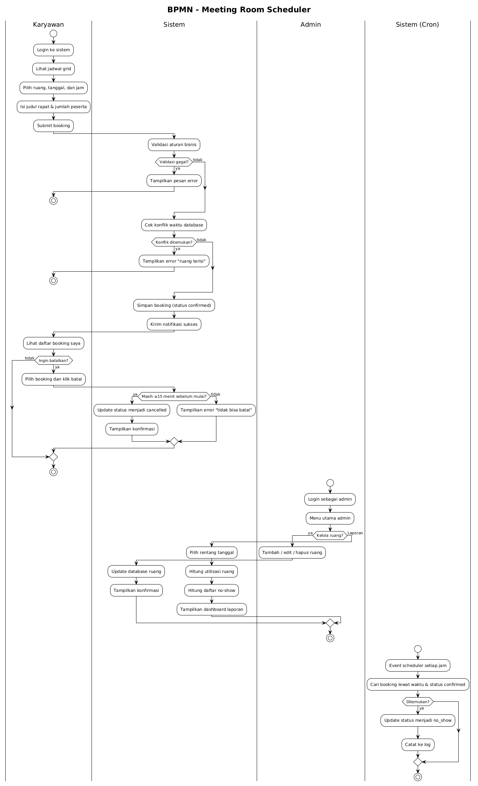
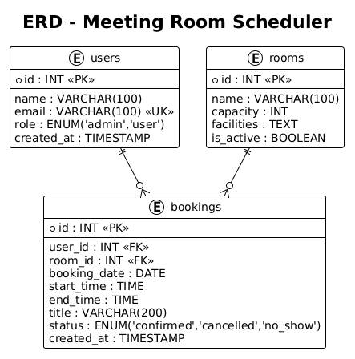

# Meeting Room Scheduler

### System Analysis & Design Documentation

An individual academic project focused on analyzing and designing a web-based meeting room booking system to support structured room scheduling, availability management, and booking administration.

<p align="center">
  
  
  
</p>

---

## 1. Project Overview

Meeting Room Scheduler is a proposed web-based system designed to organize and simplify the process of booking meeting rooms within an organization or company.

In many organizations, meeting room management can involve several operational challenges, such as:

- Conflicting meeting schedules.
- Limited information about room availability.
- Difficulties managing booking records.
- Inefficient coordination of meeting room usage.

This project documents the analysis and system design required to address these challenges through a centralized meeting room booking process.

**Important:** This repository contains system analysis and design documentation prepared before the implementation stage. It does not represent a fully implemented or deployed application.

## 2. Project Objectives

The project aims to:

1. Provide a structured process for meeting room reservations.
2. Help administrators manage meeting room and booking information.
3. Reduce potential scheduling conflicts.
4. Provide clearer information about meeting room availability.
5. Document the system design as a reference for future implementation.
6. Illustrate business processes, database structures, and system interactions through modeling diagrams.

## 3. System Scope

The proposed system covers the following activities:

| User | Administrator |
|---|---|
| Access the system | Manage meeting room data |
| View room availability | Monitor booking activities |
| Select a meeting room | Manage room information |
| Select a booking date and time | Oversee booking records |
| Submit a booking request | |

### Proposed Booking Workflow

1. **System Access** — Users access the system to view available meeting rooms and their schedules.
2. **Room & Schedule Selection** — Users select a meeting room, date, and time based on their requirements.
3. **Schedule Validation** — The system checks room availability and identifies potential scheduling conflicts.
4. **Booking Confirmation** — If the selected schedule is available, the system stores the booking information in the database and provides booking confirmation.
5. **Administrative Management** — Administrators manage room information and monitor booking activities.

## 4. System Design & Documentation

This repository contains six system modeling diagrams that describe different aspects of the proposed system.

### 4.1 Activity Diagram

Illustrates the sequence of activities performed by users and the system, starting from accessing the system and selecting a meeting room to submitting a booking request, validating availability, and saving booking information.


### 4.2 Business Process Model and Notation (BPMN)

Represents the overall business workflow involving users, the system, and administrators. It illustrates the booking request process, schedule validation, and booking data management.



### 4.3 Entity Relationship Diagram (ERD)

Describes the proposed database structure, including entities, attributes, and relationships between user information, meeting room data, and booking records.



### 4.4 Use Case Diagram

Illustrates the interaction between system actors and the proposed system functionalities.

The main actors are:

- **User:** Views room availability and submits meeting room booking requests.
- **Administrator:** Manages meeting room information and monitors booking activities.


### 4.5 Class Diagram

Describes the structural design of the system through classes, attributes, methods, and relationships between system components.


### 4.6 Sequence Diagram

Illustrates the sequence of interactions between users and system components during the booking process, including booking requests, schedule validation, and database operations.


---

## 5. Project Contributions

**Project Type:** Individual Project

This project was independently developed as an academic system analysis and design assignment.

My work focused on:

- Analyzing the business process of meeting room reservations.
- Identifying the roles and interactions of users and administrators.
- Modeling business workflows using BPMN.
- Designing system models through Activity, Use Case, Class, and Sequence Diagrams.
- Structuring database relationships using ERD.
- Preparing and organizing system design documentation.

## 6. Project Deliverables

The repository includes the following documentation:

| Deliverable | Description |
|---|---|
| Activity Diagram | System activity workflow |
| BPMN | Business process workflow |
| ERD | Database structure and relationships |
| Use Case Diagram | Actor and system interactions |
| Class Diagram | System structure and class relationships |
| Sequence Diagram | Sequence of system interactions |
| README.md | Project overview and design documentation |

## 7. Project Status

**Current Stage: System Analysis & Design — Pre-Implementation**

The project focuses on the analysis and design documentation stage. The diagrams provide a structured reference for understanding the proposed system and supporting potential future development.

Application implementation and deployment are outside the scope of this repository.

## 8. Repository Structure

```text
meeting-room-scheduler/
│
├── README.md
├── Activity Diagram.png
├── BPMN.png
├── Class Diagram.png
├── ERD.png
├── Sequence Diagram.png
└── Use Case Diagram.png
```

---

## 9. Conclusion

The Meeting Room Scheduler project provides a structured design for a proposed meeting room booking system.

Through business process analysis and six system modeling diagrams, the project documents the proposed booking workflow, actor responsibilities, database relationships, and interactions between system components.

The resulting documentation serves as a foundation and reference for future application implementation and development.

---

<div align="center">

**Meeting Room Scheduler**

*System Analysis & Design Documentation*

**Neng Audy Agustin**  
Information Systems — Universitas Esa Unggul

</div>
